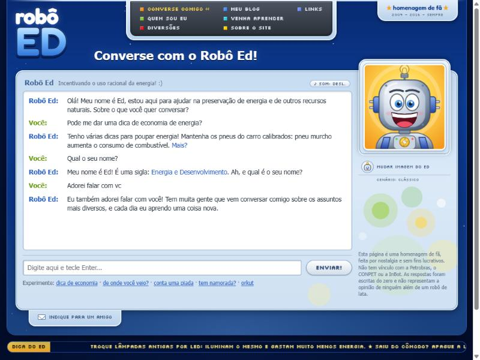

# Robô Ed: homenagem de fã

Lembra do **Robô Ed**? O robozinho que conversava com a internet brasileira de 2004 a 2016 no site do CONPET, dava dica de economia de energia e travava quando a gente xingava ele?

Este projeto recria o site dele com a estética de internet de antigamente: fundo azul estrelado, menu com fonte pixelada, contador de visitas, letreiro de dicas e o aviso "melhor visualizado em 1024x768".

### ▶ [Converse com o Ed agora: guuzribeiro.github.io/roboed](https://guuzribeiro.github.io/roboed/)

[](https://guuzribeiro.github.io/roboed/)

## O que tem

- **Converse comigo**: o chat com o Ed. Ele responde sobre energia, água, meio ambiente, planetas, piadas, Orkut, MSN, 7x1 e muito mais. Se você xingar demais, ele trava. Algumas coisas que ele faz:
  - Comenta o seu nome, igual ao original: "O nome Guilherme me lembra o Guilherme Arantes, que canta *Planeta Água*!" Ele também sabe o que o nome quer dizer.
  - Conhece os estados do Brasil ("sou de Minas", "sou carioca") e um monte de famosos (Xuxa, Senna, Einstein, Monteiro Lobato...).
  - Dá dicas de economia em listinha, com o link **Mais?** pra pedir outras, e dicas de água com o link **Outra?**.
  - Brinca de adivinhar um número, te faz perguntas de sim ou não, conta histórias e faz poemas.
  - Canta (em bipes) e pede arrego depois de um tempo. Pergunte se ele conhece o Latino!
  - Lembra o seu nome, faz contas e reclama se você repetir a mesma pergunta.
- **Quem sou eu**: a ficha técnica do Ed e botões pra ver cada expressão dele.
- **Diversões**: o joguinho *Apague as luzes!* e um quiz pra descobrir se você é um Guardião da Energia.
- **Meu blog**: posts do Ed de 2004 a 2016.
- **Venha aprender**: dicas de economia por cômodo da casa e as fontes de energia.
- **Sobre o site** e **Links**: a história do Ed original e matérias sobre ele.

## Como abrir

O jeito mais fácil é abrir o link: [guuzribeiro.github.io/roboed](https://guuzribeiro.github.io/roboed/).

Pra rodar no seu computador, não precisa instalar nada. Baixe o projeto (botão verde **Code → Download ZIP**) e dê dois cliques no `index.html`.

Funciona offline. Só as fotos do Ed, as fontes do Google e o contador de visitas precisam de internet; sem elas, o site mostra o desenho do Ed, usa fontes do próprio computador e esconde o contador.

## Como o "cérebro" funciona

O Ed original não era uma IA como as de hoje, e este também não é. As respostas ficam todas em [`js/cerebro.js`](js/cerebro.js) e o funcionamento é parecido com o de antigamente:

1. A mensagem é "limpa": tira acentos e pontuação e entende abreviações como "vc", "pq" e "tbm".
2. O Ed procura palavras-chave usando regras (expressões regulares) e escolhe a que combina melhor.
3. As respostas saem de uma "sacola" embaralhada, pra ele não repetir a mesma coisa.
4. Uma memória curtinha guarda o seu nome, o último assunto e as brincadeiras em andamento.

A conversa roda toda no navegador, sem servidor: o que você digita não vai pra lugar nenhum.

Quer ensinar coisa nova pro Ed? Abra o `js/cerebro.js` e copie uma das regras. O formato é este:

```js
{ id: 'pizza', prio: 3, h: 'feliz',
  p: [/\b(pizza|pizzaria)\b/],
  r: ['Pizza é bom demais! Dica do Ed: forno fechado esquenta mais rápido e gasta menos.'] },
```

`p` são os padrões que disparam a regra, `r` são as respostas possíveis e `h` é a cara que o Ed faz.

### Ensinar nomes, lugares e famosos

O que o Ed sabe sobre nomes fica em [`js/nomes.js`](js/nomes.js). Pra ele comentar um nome novo, copie uma linha:

```js
pietra: { d: 'Pietra', s: 'pedra', l: ['a Pedra da Gávea, lá no Rio de Janeiro'] },
```

A chave (`pietra`) é o nome em minúsculas e sem acento, `d` é como se escreve, `s` é o significado e cada item de `l` completa a frase "O nome Pietra me lembra...". Só o `d` é obrigatório. No mesmo arquivo ficam os lugares (com o jeito de chamar quem nasce lá, tipo "mineiro") e os famosos.

## Contador de visitas

O "Você é o visitante nº" do rodapé conta de verdade. Ele usa o [Abacus](https://abacus.jasoncameron.dev), um contador gratuito e aberto que não pede cadastro. Cada pessoa conta uma vez por sessão, então recarregar a página não aumenta o número. Rodando o site no seu computador, ele só mostra o total, sem somar visita.

O Abacus só recebe o pedido de "+1". Ele não fica sabendo nada da conversa.

## Estrutura

```
index.html        a página inteira (todas as seções)
css/estilo.css    o visual "internet de antigamente"
js/ed-robo.js     o desenho do Ed em SVG e as expressões dele
js/nomes.js       o que o Ed sabe sobre nomes, lugares e famosos
js/cerebro.js     o cérebro: regras, respostas e memória
js/site.js        liga tudo: chat, menu, jogo, quiz, contador
fotos/            suas fotos do Ed, opcionais (só no seu computador, veja abaixo)
```

## As fotos do Ed

O retrato mostra fotos do Ed original, carregadas **direto do site da [InBot](https://in.bot/cases/roboed/index.php)**, a empresa que criou o personagem. As imagens não ficam guardadas neste repositório, porque a arte do Ed pertence aos donos dela.

O botão **Mudar imagem do Ed** passa só pelas fotos reais. Se nenhuma foto carregar (sem internet, por exemplo), a moldura mostra um desenho do Ed feito do zero em SVG ([`js/ed-robo.js`](js/ed-robo.js)), só pra não ficar vazia.

Quer usar suas próprias fotos? Rodando o site no seu computador, salve imagens na pasta `fotos/` com os nomes `ed-1.jpg`, `ed-2.jpg`, `ed-3.jpg` e assim por diante (até `ed-12`, pode ser `.jpg` ou `.png`). Elas aparecem no lugar das fotos da InBot. A pasta `fotos/` está no `.gitignore`, então essas imagens não vão pro GitHub.

## Aviso

Esta é uma **homenagem de fã**, feita por nostalgia e sem fins lucrativos. Não tem nenhum vínculo com a Petrobras, o CONPET ou a InBot.

O Robô Ed original (2004–2016) é um personagem do CONPET/Petrobras, criado com tecnologia InBot. O nome e o personagem pertencem aos seus donos. As respostas deste projeto foram escritas do zero, imitando o jeitão do original.

Quer conversar com o Ed "de verdade"? A InBot mantém uma versão dele no ar em [roboed.in.bot](https://roboed.in.bot).

## Fontes

- [Robô Ed na Wikipédia](https://pt.wikipedia.org/wiki/Rob%C3%B4_Ed)
- [Como foi feito o Robô Ed (InBot)](https://in.bot/comofoifeitoroboed.php)
- [Case Robô Ed (InBot)](https://in.bot/cases/roboed/index.php)
- [Lembra do Robô Ed? (TechTudo)](https://www.techtudo.com.br/noticias/2023/03/lembra-do-robo-ed-chatgpt-brasileiro-foi-criado-ha-quase-20-anos-edsoftwares.ghtml)
- [Robô Ed e Akinator (CNN Brasil)](https://www.cnnbrasil.com.br/tecnologia/robo-ed-e-akinator-conheca-os-chats-com-ia-que-fizeram-sucesso-nos-anos-2000/)
- [5 chatbots que surgiram antes do ChatGPT (Canaltech)](https://canaltech.com.br/inteligencia-artificial/robo-ed-e-mais-relembre-5-chatbots-que-surgiram-antes-do-chatgpt/)
- [O "avô do ChatGPT" (Catai)](https://catai.com.br/robo-ed-o-avo-do-chatgpt-que-a-internet-brasileira-nao-esquece/)

## Licença

O código e os textos deste repositório estão sob a [licença MIT](LICENSE): pode usar, copiar, modificar e compartilhar à vontade. A licença não vale para o nome "Robô Ed" nem para o personagem original, que pertencem aos seus donos.

Achou um bug ou quer ensinar uma resposta nova pro Ed? Abre uma *issue* ou manda um *pull request*!
